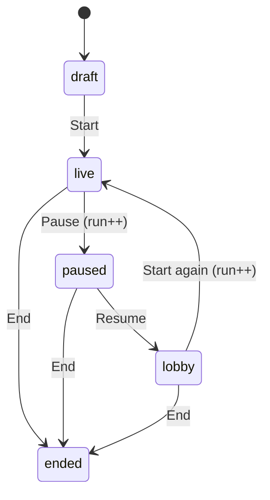

# PacePaper: class-wide pause and resume

*   **Author:** Nicholas Gowan (via OMP EGM)
*   **Status:** Proposed
*   **Date:** 2026-11-24

## Overview

Teachers running a PacePaper exam sometimes need to stop the whole class: an assembly call, a fire drill, a network change, a projector problem. Today the only choices are leaving the clock running or ending the exam, which loses the sitting.

This design adds a class-wide pause to the teacher dashboard. Pausing freezes every student's countdown, shows a hand holding a “TEST IS PAUSED” sign on student screens, and makes the question boxes inert. Saved answers stay in place. The teacher chooses Resume to send students to the lobby, where they click Join again; when the teacher starts the exam, the countdown continues from exactly where it stopped.

The design is driven by the reviewed brief in [concepts_brief.md](./concepts_brief.md) and applies to the PacePaper checkout at `~/Insync/nicholasjgowan@gmail.com/Google Drive/toys/pacepaper`.

## The Problem

The exam clock is derived from wall time: deadlines, phases, and auto-submission all compare against `started_at` plus fixed durations. A pause must therefore be more than hiding the countdown. Four problems follow, and the design addresses each one:

1. **A frozen label is not a frozen exam.** The student tick can auto-submit at the old deadline (`public/exam.js:1090–1106`), a save inside the deadline grace window can finalize (`server.ts:1163–1169`), and even a student state read can finalize an expired response (`server.ts:1104–1113`). Expiration must be suspended on every path, not just the visible clock.
2. **Requests identify the sitting, not the run.** Save, submit, audio-start, and focus requests check that the exam is live once, then await validation before writing (`server.ts:1143–1204`; `src/db.ts:1182–1219`). A pause can slip in during that wait, and a request delayed until the next live period can pass a fresh check and land in the resumed run.
3. **A second Start collides with the first.** Start resets `started_at` and inserts a fresh response row per roster member (`src/db.ts:728–753`), which collides with the existing `(session_id, student_id)` rows. Start-again must instead continue the same sitting.
4. **Students must learn about the pause promptly.** The student client polls every 30 seconds, drops refreshes that arrive during a fetch, and treats unrecognized statuses as the live exam (`public/student.js:40–54,497–560`). Pause and lobby must have explicit branches and prompt delivery, including on reconnect.

## Goals

* Goal 1: A teacher can pause an active class exam from the admin panel in one action, and the countdown for every student stops at the same remaining time.
* Goal 2: While paused and in the lobby, students see the hand-held “TEST IS PAUSED” sign, cannot interact with question boxes, cannot submit, and cannot finalize their exam by any timing path.
* Goal 3: Resuming sends students to the lobby; every student clicks Join again; Start-again continues the same sitting with the same answers, response rows, submissions, and remaining time.
* Goal 4: No write from an earlier run — save, submission, audio start, focus event, or a duplicate teacher command — can commit after the pause boundary.
* Goal 5: End remains available from any unfinished state, without restarting the clock, and the class's one-sitting reservation and data-removal guards treat frozen sittings as unfinished.
* Goal 6: An existing PacePaper database upgrades in place and reopens a frozen sitting correctly after an application restart.

## Non-Goals

*   Non-Goal 1: Per-student or per-group pause. Pause is class-wide only.
*   Non-Goal 2: Editing exam timing while a sitting is frozen. Timing edits that would move a frozen phase boundary are out of scope for this design.
*   Non-Goal 3: Roster edits that change extra-time allowances while a sitting is unfinished. The allowance is snapshotted at first Start; roster allowance changes cannot affect the unfinished sitting.
*   Non-Goal 4: Changing the projection clock's standard-time display model beyond what freezing requires.

## Open Questions

*   ~~**Audio refund policy**~~ Resolved during drafting: an interrupted listen is refunded — the allowance is restored when the sitting pauses, because the player state is discarded at teardown and a charged-but-unfinishable listen would silently spend a student's allowance.

## Critical User Journeys (CUJs)

### CUJ 1: Teacher pauses mid-exam

*   **Given**: A class is taking a live exam; students are answering questions and the countdown is running.
*   **When**: The teacher clicks Pause on the teacher dashboard.
*   **Then**: The sitting becomes paused at the current remaining time. Every student's screen switches to the pause screen (hand sign, no interaction), any save or submission already admitted before the pause completes and is preserved, and no further writes are accepted. The projected clock freezes.

### CUJ 2: Teacher resumes to lobby and starts again

*   **Given**: A paused sitting with students on the pause screen.
*   **When**: The teacher clicks Resume, students each click Join in the lobby, and the teacher clicks Start again.
*   **Then**: The same sitting becomes live again with the same response rows, the countdown continues from the frozen remaining time, phase state (including reading time and per-candidate extra time) resumes where it stopped, and students who joined in the lobby return to their paper with their saved work.

### CUJ 3: Student loses connection during pause

*   **Given**: A paused sitting; one student's device reconnects after missing the pause and resume events.
*   **When**: The device reconnects and the student state refreshes.
*   **Then**: The student sees the correct current screen (pause screen, lobby, or, after Start, their paper) based on authoritative state, never a stale live editor. The clock they return to shows the same remaining time as everyone else.

### CUJ 4: Teacher ends a frozen sitting

*   **Given**: A paused sitting or a sitting waiting in the lobby.
*   **When**: The teacher clicks End.
*   **Then**: The sitting ends without restarting its clock; responses collected so far are final and reviewable; the class's one-sitting reservation is released.

## Technical Plan (Architecture)

### Lifecycle model

The sitting gains two frozen statuses between `live` and the resumed `live`:

```
draft ──Start──▶ live ──Pause──▶ paused ──Resume──▶ lobby ──Start again──▶ live
                                     │                                    │
                                     └─────────────── End ───────────────┴──▶ ended
```

`paused` and `lobby` are additive `CHECK` values on `exam_sessions.status`, added by migration on existing databases. Every sitting also carries two new columns:

* `run` (integer, starts at 1, incremented by Pause and by Start-again) — the run fence.
* `running_ms` (accumulated milliseconds of exam time spent live, excluding paused and lobby intervals) and a `run_started_at` anchor for the current run, together replacing wall-clock arithmetic as the source of exam time.

Effective exam time at any instant = `running_ms + (now − run_started_at)` while `live`, else just `running_ms`. Remaining time = scheduled total − effective exam time. Pause sets `running_ms` to the effective value and clears the anchor; Resume-to-lobby keeps it frozen; Start-again writes a fresh anchor. Server deadline finalization (`server.ts:1104–1113`), save-grace handling (`server.ts:1163–1169`), the student tick (`public/exam.js:1090–1106`), and the countdown projection all switch to this model, so no path can expire a response during a freeze. Each candidate's extra-time allowance is snapshotted onto their response row at first Start, so the resumed deadline does not move if roster rows change while frozen.

### Run fence on writes

Every student write that mutates exam state — answer save, submit, audio-play start/complete, focus event — reads the sitting's `run` when it validates, and re-checks that same `run` value in the same transaction as its SQL write. Teacher commands (Pause, Resume, Start, End) carry the expected `run` in their request body, so a delayed duplicate Start cannot open a later lobby. The server also rejects any write whose admitted run is older than the current run, returning a definite outcome the client uses to keep the work as a recoverable local draft instead of replaying it.

### Client state machine

The student client treats `paused` and `lobby` as first-class states with their own screens (the pause screen is a real screen that takes focus and closes exam dialogs; the lobby screen offers Join). The 30-second poll stays, but lifecycle socket events trigger a refresh that queues one trailing refresh if one is already in flight, and a socket reconnect refreshes immediately. Responses are discarded if their run is older than the current run or the selection changed. The admin panel shows one clear action per state (Pause / Resume to lobby / Start again) plus End for any unfinished state, and guards that reserve the class slot or block removals treat both frozen statuses as unfinished.

### Data flow

```
Teacher dashboard ──Pause(run)──▶ server: status→paused, running_ms frozen, run++ ──socket──▶ students: pause screen
Students (in-flight saves) ──▶ admitted pre-boundary writes commit and are preserved
Teacher dashboard ──Resume(run)──▶ server: status→lobby ──socket──▶ students: lobby, Join
Students ──Join──▶ server records lobby presence (no clock, no new candidates)
Teacher dashboard ──Start(run)──▶ server: status→live, run++, fresh anchor ──socket──▶ students: paper, clock resumes
```



## Alternatives Considered

### Alternative A: Keep wall-clock deadlines and only hide the countdown

*   **Pros**: No schema change; pause is a client-only overlay.
*   **Cons**: Auto-submit, grace windows, and state-read finalization keep running on wall time, so students lose time and answers can finalize during the freeze. Rejected: it fails Goal 2 and Goal 4 outright.

### Alternative B: End the exam and create a new sitting on resume

*   **Pros**: Reuses the existing Start path untouched.
*   **Cons**: Response rows and submissions belong to the old sitting; continuing the paper means either losing answers or copying them into a new sitting with new identity, and the review/PDF history splits across two sittings. Rejected: it breaks Goal 3 and makes record keeping worse.

### Alternative C: Store pause state only in server memory

*   **Pros**: No migration at all.
*   **Cons**: A server restart during a pause loses the freeze; the review found restarts mid-sitting are a real case for the packaged app. Rejected: frozen state must survive restarts (Goal 6), which requires persisted columns.

## Detailed Implementation Plan

### Target Files to Create/Modify

#### 1. `src/db-schema.ts` (Modify)

*   **Type / Scope**: SQLite schema and migration.
*   **Proposed Changes**: Extend the `exam_sessions.status` check to `('draft','live','paused','lobby','ended')`; add `run INTEGER NOT NULL DEFAULT 1`, `running_ms INTEGER NOT NULL DEFAULT 0`, and nullable `run_started_at` to `exam_sessions`; add a per-candidate allowance snapshot (`extra_minutes_snapshot REAL`) to responses, written at first Start. Add the migration that alters existing databases (additive `ALTER TABLE` only; no table rebuild), defaulting `run` to 1 and leaving live sittings untouched.

#### 2. `src/db.ts` (Modify)

*   **Type / Scope**: Persistence and transaction layer.
*   **Proposed Changes**: New transition functions `pauseExamSession`, `resumeExamSessionToLobby`, `startExamSessionAgain`, and an End that accepts `live | paused | lobby`, each enforcing the current `run` inside its transaction and updating `status`/`run`/`running_ms`/`run_started_at` together. Effective-time helpers: `effectiveExamMs(session, now)` and per-response remaining time using the snapshotted allowance. First Start writes `extra_minutes_snapshot`. Rework deadline finalization and save-grace to use effective time. Update guard predicates — one-sitting-per-class reservation, remove class/student/sitting, disable sharing — to treat `paused` and `lobby` as unfinished. Rework answer-save and submit writes to compare the admitted run with the sitting's run in the write transaction.

#### 3. `src/timing.ts` (Modify)

*   **Type / Scope**: Exam timing model.
*   **Proposed Changes**: Accept an effective-time input (accumulated `runningMs` plus live anchor) instead of deriving phase boundaries from `startedAt` alone; expose a resume path that reconstructs the current phase and remaining milliseconds from frozen state, including per-candidate extra time from the snapshot.

#### 4. `server.ts` (Modify)

*   **Type / Scope**: HTTP and socket API.
*   **Proposed Changes**: Teacher endpoints for Pause, Resume-to-lobby, Start-again, and End-from-frozen, each requiring the expected run and returning the new lifecycle state; student write routes (save, submit, audio start/complete, focus) record the run at validation and re-check it inside the write transaction; authoritative student state and `/api/bootstrap` include `run` and the effective phase/deadline; socket broadcasts for `exam-paused`, `exam-lobby`, and `exam-resumed`; the startup log prints the frozen state on reopen.

#### 5. `public/student.js` (Modify)

*   **Type / Scope**: Student client state machine.
*   **Proposed Changes**: First-class `paused` and `lobby` branches with their own screens (unknown statuses no longer fall through to the exam); the pause screen takes focus, closes exam dialogs, and renders the hand-held sign; the lobby screen offers Join. Refresh handling: queue one trailing refresh when a lifecycle event arrives mid-fetch; refresh on socket reconnect; discard responses whose run is stale or whose selection changed.

#### 6. `public/exam.js` (Modify)

*   **Type / Scope**: Exam editor and timing.
*   **Proposed Changes**: Mount-generation checks on save callbacks, retry scheduling, and submit handover so an old editor cannot clear or rewrite the resumed editor's draft; the tick and auto-submit switch to server-published effective phase/deadline; on receiving Pause, hand over to the pause screen (dialogs closed, submit buttons disabled) while preserving the local draft for reconciliation on rejoin.

#### 7. `public/countdown.js` and `public/countdown-model.js` (Modify)

*   **Type / Scope**: Projection clock.
*   **Proposed Changes**: The projection treats `paused` and `lobby` as frozen groups (display the frozen remaining time with a paused label); remaining-time computation uses the effective-time model rather than wall-clock phase arithmetic.

#### 8. `public/admin.js`, `public/admin-collections.js`, `public/admin-end-exam.js` (Modify)

*   **Type / Scope**: Teacher dashboard.
*   **Proposed Changes**: One clear primary action per state — Pause (live), Resume to lobby (paused), Start again (lobby) — with End available for any unfinished state and correct confirmation/announcement wording per transition (no blanket "exam ended" message for Pause/Resume); status pills and the live-work view render frozen states; removal and sharing guards follow the unfinished-state predicates from `src/db.ts`.

#### 9. `public/exam-audio.js` and `src/audio-playback.ts` (Modify)

*   **Type / Scope**: Audio listens.
*   **Proposed Changes**: Audio tickets are bound to the sitting's run; outstanding tickets are retired at Pause, and an interrupted listen is refunded (allowance restored) rather than kept charged — the player state is already discarded at teardown, so charging an unfinishable listen would silently spend a student's allowance.

#### 10. `pause-resume.test.ts` (Create)

*   **Type / Scope**: Server integration tests.
*   **Proposed Changes**: Populated prior-release database migration and reopen of a sitting frozen in each state; deterministic interleavings of Pause with save, submit, and a held refresh (stale-run requests rejected, admitted pre-boundary writes preserved); teacher command run fence (delayed duplicate Start rejected); restart persistence of frozen state; exact remaining time for standard and accommodated candidates after resume.

#### 11. `public/student-flow.test.js`, `public/countdown-model.test.js`, `src/db.test.ts` (Modify)

*   **Type / Scope**: Unit test updates.
*   **Proposed Changes**: Extend existing suites for the new statuses, effective-time model, snapshot allowances, queued refresh, and End-from-frozen paths; keep the suite stubs consistent with the new API shapes.

#### 12. `USER_GUIDE.md`, `USER_GUIDE.html`, `README.md` (Modify)

*   **Type / Scope**: Teacher documentation.
*   **Proposed Changes**: Document Pause/Resume/Start-again in the exam-running steps, the frozen-clock behavior, and the End-from-frozen path; regenerate `USER_GUIDE.html` with `bun run guide:build`.

### Verification Plan

*   **Compilation/Build**: `bun run check` (TypeScript) and `bun run guide:build` for the regenerated guide.
*   **Unit Tests**: `bun test` — the full suite, including the modified suites above and the existing classroom-sharing startup test.
*   **Integration**: `pause-resume.test.ts` covering migration, run fence, restart persistence, and per-candidate allowances.
*   **E2E/Manual**: One teacher/remote-student run on the classroom LAN: pause mid-answer, verify the sign screen and inert boxes, resume to lobby, join from two devices, start again, and confirm the countdown resumes at the frozen value for both a standard and an accommodated candidate; then End from the paused state and confirm the sitting reviews as ended.

